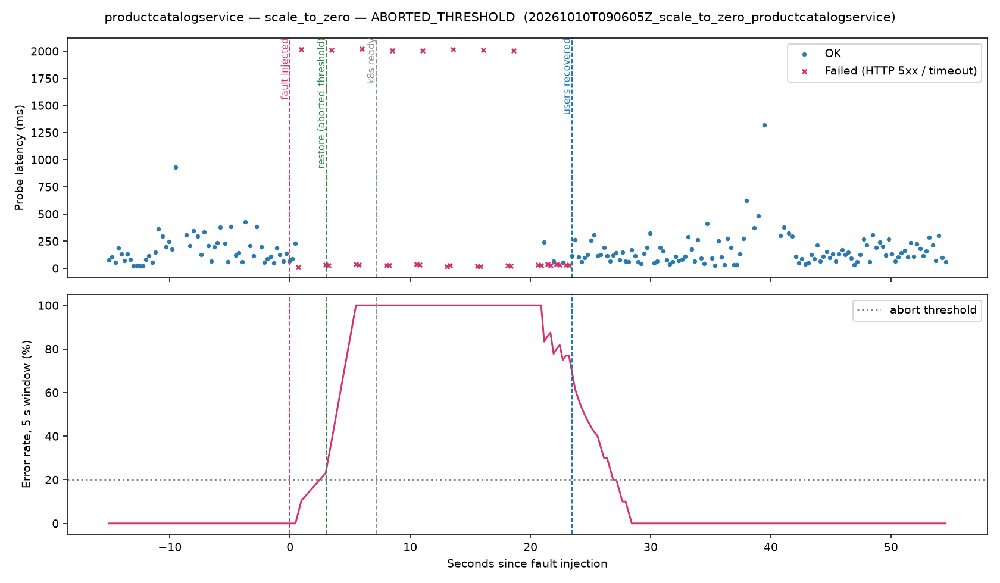
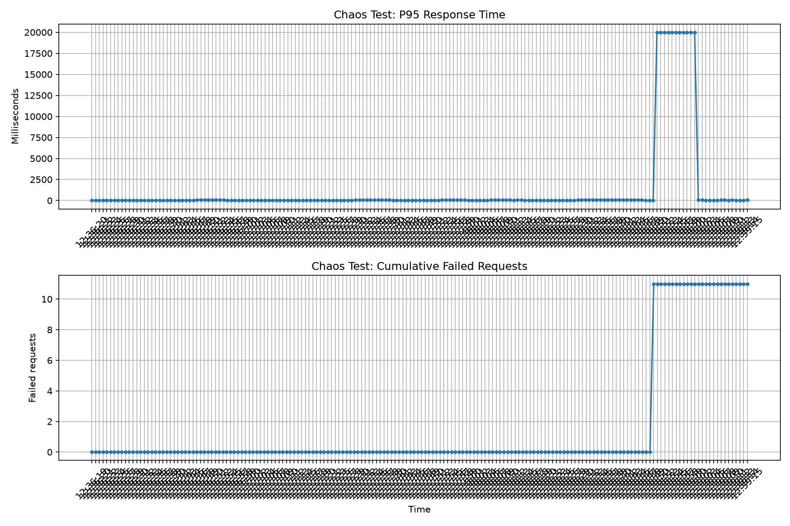

# Kubernetes Chaos Engineering — Online Boutique

A local Kubernetes resilience experiment using Kind, Locust, and Python to observe application behavior during a controlled microservice disruption.

## Overview

This project uses Google's [Online Boutique](https://github.com/GoogleCloudPlatform/microservices-demo) as the application under test. The application runs in a local Kind Kubernetes cluster while Locust generates HTTP traffic.

The experiment compares a baseline load test with a test in which the `productcatalogservice` deployment is scaled down and restored.

**My contribution:** Kubernetes experiment setup, controlled service disruption, Locust load testing, CSV result collection, and performance visualization.

## Architecture

```text
Locust Load Test
       |
       v
Frontend Service
       |
       v
Online Boutique Microservices
       |
       v
Product Catalog Service
       ^
       |
Scale deployment to zero
and restore the replica
       |
       v
Kubernetes recovery

Locust CSV results
       |
       v
Python + Matplotlib
       |
       v
Performance timeline chart
```

This is a conceptual view of the experiment, not a complete service dependency diagram.

## Technology Stack

- Kubernetes and Kind
- Docker Desktop
- kubectl
- Locust
- Python and Matplotlib

## Environment

- Cluster: `boutique-chaos`
- Namespace: `boutique`
- Load-test target: `http://localhost:8080`
- Application: Online Boutique microservices demo

## Experiments and Results

### Baseline load test

Configuration:
- Concurrent users: 10
- Spawn rate: 1 user per second
- Duration: 3 minutes

Results:
- Requests: 383
- Failed requests: 0
- Failure rate: 0%
- Average response time: approximately 17 ms
- Median response time: 13 ms
- 95th percentile response time: 37 ms
- Maximum response time: 96 ms
- Throughput: approximately 2.15 requests/second

### Product catalog disruption

During a Locust load test, `productcatalogservice` was scaled to zero replicas and then restored to one replica.

Results recorded by Locust:
- Requests: 351 in the aggregate CSV
- Failed requests: 11
- Failure rate: approximately 3.13%
- Average response time: approximately 491.82 ms
- Median response time: 13 ms
- 95th percentile response time: 60 ms
- Maximum response time: approximately 20.01 seconds
- Throughput: approximately 1.97 requests/second

The failure report records HTTP 500 responses affecting product-page requests, `/cart`, and `/setCurrency`.

The experiment coincided with the service scale-down and restoration. Individual failure timestamps have not yet been correlated with the precise outage window, so causality has not been conclusively established for every error.

### Recovery

The `productcatalogservice` deployment subsequently rolled out successfully, and the application pods were observed in the `Running` and ready state.

## Day 1: Safety-Controlled Experiments

Failures are injected by `chaos/controller.py`. It does not take shell commands; it only runs one approved fault on one allowlisted deployment.

### Safety controls

| Control | Implementation |
|---|---|
| Scope lock | Fixed context `kind-boutique-chaos`, namespace `boutique`; probe URL must be localhost |
| Target allowlist | 10 backend deployments; `frontend` (telemetry path) and `loadgenerator` are refused |
| Fault allowlist | `scale_to_zero` only (reversible) |
| Duration cap | Hard maximum 60 s, not overridable |
| Preflight gate | Refuses to run unless every deployment is ready, no previous fault is pending and the kill switch is clear |
| Baseline gate | 15 s of healthy probes required before injecting |
| Automatic abort | Restores immediately if probe error rate > 20 % or P95 > 1000 ms over a 5 s window, or if telemetry is lost |
| Kill switch | Create `chaos/KILL`, or press Ctrl+C |
| Guaranteed cleanup | `try/finally` restores the **original** replica count; Ctrl+C is ignored during cleanup; 3 retries |
| Crash recovery | State file `chaos/state/active_fault.json` + `chaos/restore.py` undo a fault if the controller dies |
| Recovery check | `kubectl rollout status` **and** 5 consecutive successful user requests |
| Evidence | `results/runs/<run_id>/` holds `events.jsonl`, `probes.csv`, `summary.json`, Locust CSVs and `timeline.png` (UTF-8, UTC) |

Rejected requests are logged to `results/runs/rejected.jsonl`.

### Day-1 runs (measured)

| Run | Target | Outcome | Fault duration | User errors during fault | K8s ready after restore | Users recovered after restore |
|---|---|---|---|---|---|---|
| `20261010T090605Z` | productcatalogservice | **Auto-abort** (error rate 23 % > 20 %) | 3.05 s | 3 of 5 probes | 4.1 s | **20.4 s** |
| `20261010T091112Z` | adservice | Completed at 60 s cap | 60.1 s | 0 of 232 probes | 63.7 s | no user impact |
| `20261010T091455Z` | adservice | **Kill switch** (`chaos/KILL`) | 10.1 s | 0 of 39 probes | 47.1 s | no user impact |
| rejected | frontend / 600 s duration | Refused before touching the cluster | — | — | — | — |

The probe sends sequential HTTP requests to `/`, `/product/OLJCESPC7Z` and `/cart` every 0.25 s, with a 2 s timeout. Locust load ran in parallel for the auto-abort run.



### Initial findings

1. **Readiness does not equal user recovery (productcatalogservice).** Kubernetes reported the pod ready 4.1 s after restore, but users kept receiving HTTP 500s until 20.4 s after restore. A 3 s fault produced about 23 s of user-facing outage. *Hypothesis (not yet verified):* the frontend's gRPC connection to the catalog does not reconnect immediately.
2. **The product catalog is a single point of failure.** With one replica, its loss breaks `/`, product pages, `/cart`, `/setCurrency` and checkout within 1 s.
3. **The ad service degrades gracefully but restarts slowly.** It caused 0 user errors while down, but took 47–64 s to become ready again.
4. **Detection latency.** The auto-abort fired 3.05 s after injection, because a hung `/cart` probe (2 s timeout) blocked the sequential prober. The first error was seen at 0.7 s.

### Dependency map

`architecture/build_dependency_map.py` discovers services and `*_ADDR` dependencies from the live cluster and merges experiment evidence from `architecture/observations.json`. See [architecture/dependency-map.md](architecture/dependency-map.md). It also flags that the frontend is configured to call `shoppingassistantservice`, which is not deployed.

### Running the controller

```powershell
.\.venv313\Scripts\Activate.ps1
python chaos\controller.py --target productcatalogservice --duration 45 --load-users 10   # auto-abort demo
python chaos\controller.py --target adservice --duration 60                              # then: New-Item chaos\KILL
Remove-Item chaos\KILL                                                                   # re-arm
python chaos\restore.py                                                                  # emergency undo
python chaos\plot_run.py results\runs\<run_id>                                           # timeline chart
python architecture\build_dependency_map.py                                              # dependency map
```

## Results and Visualization

The `results/` directory contains the Locust reports and generated chart.

Key files:
- `results/baseline2_stats.csv`
- `results/baseline2_stats_history.csv`
- `results/chaos2_stats.csv`
- `results/chaos2_stats_history.csv`
- `results/chaos2_failures.csv`
- `results/chaos2_timeline.png`



## Reproduction

The recorded tests used a local Kind cluster, a deployed Online Boutique application, and a frontend port-forward to `localhost:8080`.

Run the baseline load test from the repository root:

```powershell
python -m locust -f src/loadgenerator/locustfile.py --host http://localhost:8080 --headless --users 10 --spawn-rate 1 --run-time 3m --csv results/baseline2 --csv-full-history
```

For the disruption experiment, start a separate Locust run with a different CSV prefix, then scale the product catalog deployment down and restore it:

```powershell
kubectl --context kind-boutique-chaos scale deployment/productcatalogservice -n boutique --replicas=0
kubectl --context kind-boutique-chaos scale deployment/productcatalogservice -n boutique --replicas=1
kubectl --context kind-boutique-chaos rollout status deployment/productcatalogservice -n boutique --timeout=120s
```

Generate the visualization from the saved chaos-test history:

```powershell
python create_chart.py
```

These commands assume the cluster, application, port-forward, Python environment, and dependencies are already configured. This README does not yet document a complete clean-machine setup.

## Limitations

- The experiment ran on a local Kind cluster, not a production Kubernetes environment.
- The baseline and disruption runs may differ in request timing and distribution.
- The exact failure-injection window has not been correlated with individual request timestamps.
- Results are specific to this test configuration and should not be generalized to production workloads.
- Repeated trials would improve confidence in the observations.

## Conclusion

The baseline test recorded no failed requests. During the disruption experiment, Locust recorded 11 failures and a maximum response time of approximately 20 seconds. Kubernetes subsequently restored the deployment. Timestamp correlation and repeated experiments are the next steps toward a stronger resilience assessment.

## Upstream Project

The application used for this experiment is Google's [Online Boutique microservices demo](https://github.com/GoogleCloudPlatform/microservices-demo). The chaos-testing procedure, experiment reports, and visualization in this repository document the work added for this project.
