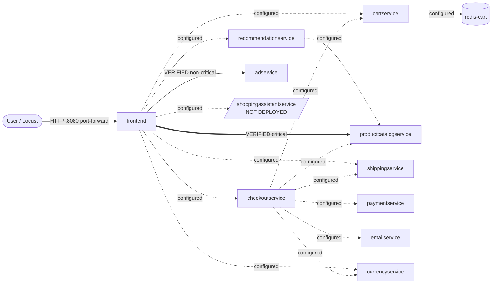

# Online Boutique — Dependency Map

Generated 2026-10-10T09:18:34+00:00 from the live `kind-boutique-chaos` cluster, namespace `boutique`, by `architecture/build_dependency_map.py`. Verified edges come from `architecture/observations.json`.

Legend: **thick arrow** = removal caused user-facing errors in an experiment; **solid** = removed in an experiment with no user-facing errors; **dotted** = configured in the Deployment env but not yet tested.

## Services

| Deployment | Role | Replicas | Ports | Image |
|---|---|---|---|---|
| adservice | backend | 1 | 9555 | `adservice:v0.10.7` |
| cartservice | backend | 1 | 7070 | `cartservice:v0.10.7` |
| checkoutservice | backend | 1 | 5050 | `checkoutservice:v0.10.7` |
| currencyservice | backend | 1 | 7000 | `currencyservice:v0.10.7` |
| emailservice | backend | 1 | 8080 | `emailservice:v0.10.7` |
| frontend | entry point | 1 | 8080 | `frontend:v0.10.7` |
| loadgenerator | load generator (not part of app) | 0 | — | `loadgenerator:v0.10.7` |
| paymentservice | backend | 1 | 50051 | `paymentservice:v0.10.7` |
| productcatalogservice | backend | 1 | 3550 | `productcatalogservice:v0.10.7` |
| recommendationservice | backend | 1 | 8080 | `recommendationservice:v0.10.7` |
| redis-cart | datastore | 1 | 6379 | `redis:alpine` |
| shippingservice | backend | 1 | 50051 | `shippingservice:v0.10.7` |

## Edges

| From | To | Env var | Evidence | Criticality |
|---|---|---|---|---|
| cartservice | redis-cart | `REDIS_ADDR` | configured | unknown (not yet tested) |
| checkoutservice | productcatalogservice | `PRODUCT_CATALOG_SERVICE_ADDR` | configured | unknown (not yet tested) |
| checkoutservice | shippingservice | `SHIPPING_SERVICE_ADDR` | configured | unknown (not yet tested) |
| checkoutservice | paymentservice | `PAYMENT_SERVICE_ADDR` | configured | unknown (not yet tested) |
| checkoutservice | emailservice | `EMAIL_SERVICE_ADDR` | configured | unknown (not yet tested) |
| checkoutservice | currencyservice | `CURRENCY_SERVICE_ADDR` | configured | unknown (not yet tested) |
| checkoutservice | cartservice | `CART_SERVICE_ADDR` | configured | unknown (not yet tested) |
| frontend | productcatalogservice | `PRODUCT_CATALOG_SERVICE_ADDR` | configured; verified by chaos5 (manual), 20261010T090605Z_scale_to_zero_productcatalogservice | critical |
| frontend | currencyservice | `CURRENCY_SERVICE_ADDR` | configured | unknown (not yet tested) |
| frontend | cartservice | `CART_SERVICE_ADDR` | configured | unknown (not yet tested) |
| frontend | recommendationservice | `RECOMMENDATION_SERVICE_ADDR` | configured | unknown (not yet tested) |
| frontend | shippingservice | `SHIPPING_SERVICE_ADDR` | configured | unknown (not yet tested) |
| frontend | checkoutservice | `CHECKOUT_SERVICE_ADDR` | configured | unknown (not yet tested) |
| frontend | adservice | `AD_SERVICE_ADDR` | configured; verified by 20261010T091112Z_scale_to_zero_adservice | non-critical (graceful degradation) |
| frontend | shoppingassistantservice | `SHOPPING_ASSISTANT_SERVICE_ADDR` | configured; **target not deployed** | unknown (not yet tested) |
| loadgenerator | frontend | `FRONTEND_ADDR` | configured | unknown (not yet tested) |
| recommendationservice | productcatalogservice | `PRODUCT_CATALOG_SERVICE_ADDR` | configured | unknown (not yet tested) |

## Experimental evidence

- **frontend → productcatalogservice** (critical): Scaling productcatalogservice to 0 caused HTTP 500 on /, /product/*, /cart, /setCurrency and /cart/checkout within 0.7-1 s; /cart probes hung >2 s. In run 090605Z Kubernetes reported ready 4.1 s after restore but users kept getting 500s until 20.4 s after restore.
- **frontend → adservice** (non-critical (graceful degradation)): adservice at 0 replicas for 60.1 s: 0 errors in 232 probes during the fault window. After restore, Kubernetes took 63.7 s to report it ready.

## Limits

- Configured edges show the code *can* call a service; they don't prove which requests use it.
- Only edges whose target was actually removed in an experiment are marked verified.
- Data flow summary (from upstream architecture docs, not verified here): browsing uses productcatalog, currency, ads and recommendations; cart uses cartservice → redis-cart; checkout orchestrates cart, productcatalog, currency, shipping, payment and email.
