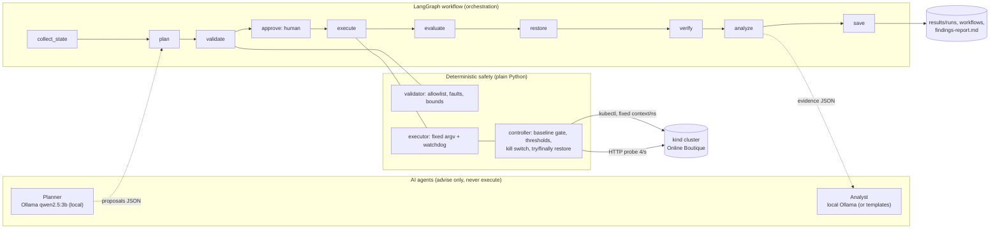

# Architecture Overview: AI-Driven Chaos Engineering (one page)

**Goal:** break one part of a cloud-native app on purpose, safely, and learn from it. **App under test:** Google Online Boutique (11 microservices) on a local **kind** cluster (`kind-boutique-chaos`, namespace `boutique`).

| Component | File | What it does |
|---|---|---|
| Dependency map | `architecture/build_dependency_map.py` | Reads live Deployments; edges from `*_ADDR` env vars (**configured**). Experiments mark edges **verified** (`observations.json`) |
| Planner agent | `chaos/planner.py` | Ollama with JSON-schema-constrained output. Inputs: dependency map, cluster health, baseline, previous runs, fault catalog. Output: ranked proposals (ID, target, fault, parameters, abort conditions, hypothesis, reason, recovery plan) |
| Validator | `planner.validate()` | Plain code. Rejects unknown targets, unsupported faults, out-of-range values; thresholds may only be **tightened** |
| Workflow | `chaos/workflow.py` | LangGraph `StateGraph`, 10 nodes, conditional edges, `interrupt()` for human approval, audit record per run |
| Executor | `chaos/executor.py` | Builds the controller command from validated fields (no shell); **independent watchdog** kills a hung run and calls `restore.py` |
| Controller | `chaos/controller.py` | Injects one fault; probes the shop; auto-abort; kill switch; restore in `finally`; recovery check; evidence |
| Analyst agent | `chaos/analyze.py` | Code computes facts, severity, rank and score. A local Ollama model (`llama3.2:3b` if pulled, else `qwen2.5:3b`) writes cause hypotheses, fixes and verification experiments only; a number guard rejects invented figures. No cloud API |
| Latency lab | `chaos/netem_lab.py` + `latency-lab.yaml` | Two disposable pods; `tc netem` on the lab server only; before/during/after curl + ping; removal verified; lab pods deleted |
| UI | `ui/app.py` + `chaos/api.py`, `chaos/dashboard.py` | Streamlit control centre; live chart dashboard |

**Fault types on the application:** `scale_to_zero` (service outage) · `pod_delete` (crash) · `traffic_spike` (≤150 Locust users, spawn ≤20/s). **Network latency** (netem 20–500 ms) runs only on the disposable `chaos-lab-server` pod; latency on application pods is disabled (empty allowlist) until validated.

**LLM runtime:** everything uses the Ollama API at `OLLAMA_URL` (default `localhost:11434`). Msty can serve the models instead **if** its Local AI Service endpoint is Ollama-compatible (unverified; check the endpoint in Msty's settings and run `cli.py health`).

**Safety controls:** target and fault allowlists · 60 s hard cap (planner: 30 s) · pre-check (cluster healthy, no kill switch, no pending fault) · 15 s healthy baseline gate · auto-abort (error rate >20% or P95 >1 s over 5 s, tightenable) · telemetry-loss abort · kill switch (`chaos/KILL` or Ctrl+C) · `try/finally` restore to the **original** replica count, Ctrl+C ignored during cleanup · crash-safe state file + `restore.py` · watchdog · command timeouts and return-code checks · recovery = rollout ready **and** 5 consecutive good requests · human approval before every injection · JSONL audit logs.

**What the AI decides vs. what code decides:** the AI *suggests* what to break and *explains* what broke. Code decides whether it's allowed, runs it, stops it, measures it and scores it.
